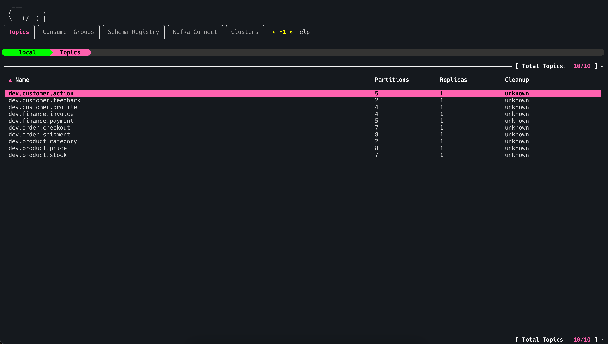
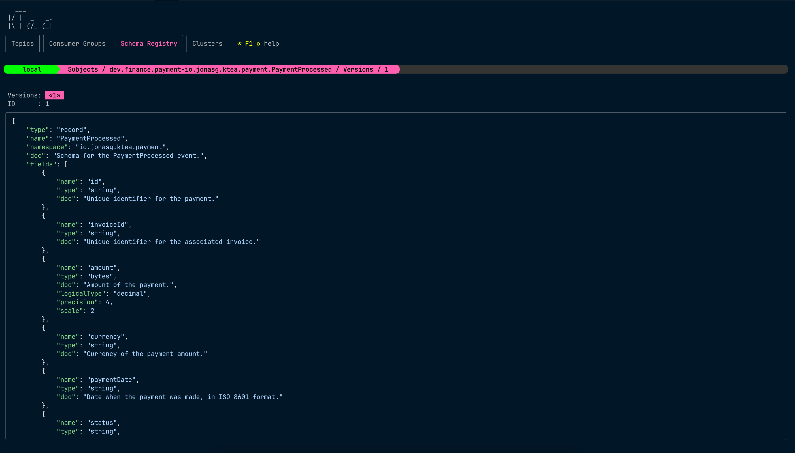
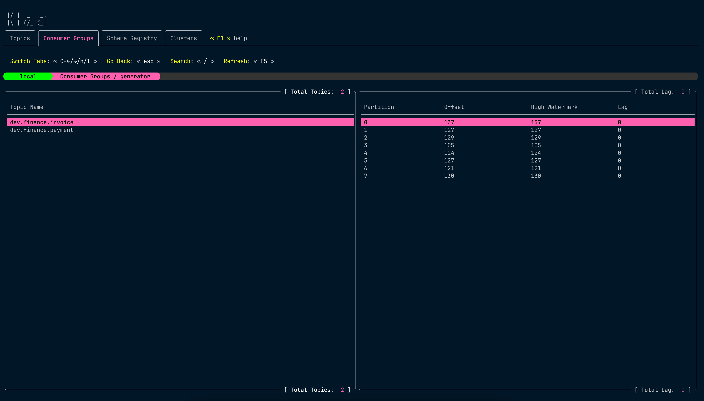

[](https://github.com/jonas-grgt/ktea/releases)
[](https://github.com/jonas-grgt/ktea/actions)
[](https://raw.githack.com/wiki/jonas-grgt/ktea/coverage.html)

# 🫖 ktea - kafka terminal client

ktea is a tool designed to simplify and accelerate interactions with Kafka clusters.

If you're a **k9s** user, you'll love **ktea**!

**List Topics**


**View AVRO Schema**


**View Consumer Lag**


## Installation

### Mac

```sh
brew tap jonas-grgt/ktea
brew install ktea
```

### Linux

Binaries are available at the release page.

### Windows

Binaries are available at the release page.

## Usage

### Navigation

All tables can be navigated using vi like bindings:
- up: `j`
- down: `k`
- page down: `d`
- page up: `u`

### Configuration

All configuration is stored in `~/.config/ktea/config.yaml`

All cluster configurations can be managed through the TUI even the initial one.

Example configuration file:

```yaml
plain-fonts: true # when nerd-fonts are not available, set to true
clusters:
    - name: local
      color: '#FF0000'
      active: true
      servers:
          - localhost:9093
      sasl:
          authMethod: NONE
      tls:
          enable: true
          skipVerify: false
          caCertPath: "docker/cert/ca.crt"
      schema-registry:
          url: http://localhost:8081
          username: "user"
          password: "secret"
      kafka-connect-clusters:
          - name: PRD
            url: http://localhost:8083
            username: "admin"
            password: "secret"
```

### Themes

ktea comes with several color themes, and you can write your own.
Choose one with the `theme` key in `~/.config/ktea/config.yaml`:

```yaml
theme: desert
```

Or open the **Settings** tab, select a theme and press `enter`: it is applied right away and saved to `config.yaml`.
Themes you add to the themes folder show up there the next time you open the tab.
If you edit `config.yaml` by hand, restart ktea to pick up the change.

#### Built-in themes

| Theme        | Description                                                                           |
|--------------|---------------------------------------------------------------------------------------|
| `default`    | ktea's original pink and indigo colors. Used when `theme` is not set.                 |
| `dracula`    | The [Dracula](https://draculatheme.com) palette, with Alucard on light terminals.     |
| `catppuccin` | The [Catppuccin](https://catppuccin.com/palette/) palette: Mocha when dark, Latte when light. Paints the flavor's background. |
| `catppuccin-latte`, `catppuccin-frappe`, `catppuccin-macchiato`, `catppuccin-mocha` | One Catppuccin flavor, always, whatever your terminal's background. Paints the flavor's background. |
| `desert`     | Muted sand gold and sage green. Paints the whole terminal dark brown when dark.       |
| `tokyonight` | [Tokyo Night](https://github.com/folke/tokyonight.nvim): Night when dark, Day when light. |
| `tokyonight-night`, `tokyonight-storm`, `tokyonight-moon`, `tokyonight-day` | One Tokyo Night style, always. |
| `gruvbox`    | [Gruvbox](https://github.com/morhetz/gruvbox): dark or light, following the terminal. |
| `gruvbox-dark`, `gruvbox-light` | One Gruvbox mode, always. |
| `nord`       | [Nord](https://www.nordtheme.com), dark only. |
| `rose-pine`  | [Rosé Pine](https://rosepinetheme.com/palette/): Main when dark, Dawn when light. |
| `rose-pine-main`, `rose-pine-moon`, `rose-pine-dawn` | One Rosé Pine variant, always. |
| `solarized`  | [Solarized](https://ethanschoonover.com/solarized/): dark or light, following the terminal. |
| `solarized-dark`, `solarized-light` | One Solarized mode, always. |
| `onedark`    | Atom's [One Dark](https://github.com/atom/one-dark-syntax), dark only. |

All themes except `default`, `dracula` and `desert` paint their own background, and they highlight
record payloads with the matching syntax style.

Most themes have a dark and a light variant.
When ktea starts, it asks your terminal whether its background is dark or light and uses the matching variant.
Themes named after one variant, such as `catppuccin-mocha` or `gruvbox-light`, always use that variant, and so do `nord` and `onedark`.

Themes that paint the background also set the default text color, and ktea restores your terminal's own colors when you switch to another theme or quit.

#### Creating your own theme

1. Create the folder `~/.config/ktea/themes/`.
2. Add a file `<name>.yaml` to it, for example `~/.config/ktea/themes/ocean.yaml`.
3. Set `theme: ocean` in `config.yaml` (the file name without `.yaml`).
4. Start ktea.

A custom theme starts from a built-in theme (its `base`) and changes only the colors you list.
A small file is enough to tweak an existing theme:

```yaml
# ~/.config/ktea/themes/my-dracula.yaml
base: dracula
dark:
  primary: "#50fa7b"
```

The file has these keys. All of them are optional:

| Key      | Meaning                                                                                                                  |
|----------|--------------------------------------------------------------------------------------------------------------------------|
| `base`   | Built-in theme to start from. Defaults to `default`.                                                                     |
| `dark`   | Colors used on a dark terminal background.                                                                               |
| `light`  | Colors used on a light terminal background. When missing, the `dark` colors are used for light terminals too.           |
| `syntax` | [Chroma style](https://xyproto.github.io/splash/docs/) used to highlight record payloads, e.g. `monokai` or `nord`.       |

Colors are hex values (`"#ff79c6"`) or ANSI color numbers 0-255 (`"212"`).
Always put colors in quotes, because YAML treats an unquoted `#` as the start of a comment.

These colors can be set under `dark` and `light`:

| Color          | Used for                                                             |
|----------------|----------------------------------------------------------------------|
| `primary`      | active tab, table selection, highlighted counts, buttons             |
| `primaryMuted` | inactive counts and selected-but-unfocused chips                     |
| `accent`       | prompts and form titles                                              |
| `highlight`    | keys in the help screen                                              |
| `text`         | regular text                                                         |
| `textMuted`    | secondary text and inactive border titles                            |
| `textFaint`    | inactive tabs and placeholders                                       |
| `onPrimary`    | text drawn on a `primary` background                                 |
| `surface`      | status bar background                                                |
| `surfaceAlt`   | inactive chips and buttons                                           |
| `borderFocus`  | border of the focused element                                        |
| `borderBlur`   | border of unfocused elements                                         |
| `active`       | active tab inside a bordered box                                     |
| `success`      | success messages                                                     |
| `error`        | error messages                                                       |
| `background`   | paints the whole terminal background while ktea runs and makes `text` the default text color (leave it out to keep your terminal's colors) |

A complete theme that sets every color:

```yaml
# ~/.config/ktea/themes/ocean.yaml
syntax: nord
dark:
  primary: "#5fb3d9"
  primaryMuted: "#3d7a99"
  accent: "#7fd1b9"
  highlight: "#e6c07b"
  text: "#d8e3ea"
  textMuted: "#9fb2bf"
  textFaint: "#6b7f8c"
  onPrimary: "#0f1a21"
  surface: "#1d2b35"
  surfaceAlt: "#26394a"
  borderFocus: "#7fd1b9"
  borderBlur: "#26394a"
  active: "#5fb3d9"
  success: "#7fd1b9"
  error: "#e06c75"
  background: "#0f1a21"
light:
  primary: "#1f6f99"
  accent: "#2f8f74"
  text: "#14232d"
  onPrimary: "#ffffff"
```

The `light` section above only lists four colors. That is fine: colors you leave out come from `base`,
not from `dark`, so here they are taken from the `default` theme's light variant.

If a theme file has a mistake, such as an unknown color name, an invalid color or an unknown base,
ktea does not start and prints which field is wrong, for example:

```
ktea: theme "ocean": unknown color dark.primry
```

Cluster colors are set per cluster (see above) and do not change with the theme.

### Cluster Management

Multiple clusters can be added.
Upon startup when no cluster is configured, you will be prompted
to add one.

#### TLS support

- TLS can be enabled by setting `tls.enabled` to true in the cluster configuration.
- `tls.skipVerify` can be set to true to skip TLS certificate verification (not recommended for production).
- `tls.caCertPath` can be set to the path of the CA certificate to use

#### Supported Auth Methods

- None (no authentication)
- SASL 
    - Plaintext

## Features

- *Multi-Cluster Support*: Seamlessly connect to multiple Kafka clusters and switch between them with ease.
- *Topic Management*: List, create, delete, and modify topics, including partition and offset details.
- *Record Consumption*: Consume records in text, JSON, and **Avro** formats, with powerful search capabilities.
- *Consumer Group Insights*: Monitor consumer groups, view their members, and track offsets.
- *Schema Registry Integration*: Browse, view, and register schemas effortlessly.
- *Kafka Connect Integration*: Browse, view, and Update clusters.

## Todo

- Add more authentication methods
- Add support for more message formats such as protobuf.
- Add ACL management.
- File based import/export of topics.
- Add ability to delete specific schema versions.
- Add consumption templating support.
- Many more, just file an issue requesting a feature!

## Development

### Dev cluster setup

A docker-compose setup is provided to quickly spin up a local Kafka cluster with pre-created topics, consumer groups,
commited offsets etc ...

`docker/docker-compose.yml` contains a cluster, schema-registry and kafka-connect setup.
`docker/docker-compose-ssl.yml` contains a ssl enabled cluster only

### Generate data

After the local cluster is up and running, you can generate some data to work with, 
using`go run ./cmd/generate`.

### Run `ktea`

Use `go run -tags dev cmd/ktea/main.go` to run `ktea` from the root of the repository.

> Note: running the tui with dev build tag will simulate an artificial slow network by sleeping for 2 seconds when doing network IO. This way the loaders and spinners can be visually asserted.
> 

### Run tests

Because of interfering testcontainers kafka brokers the tests, for now, can't be run in parallel.
This will be fixed in the future.

```sh
go test -count=1 ./...  -p 1
```
